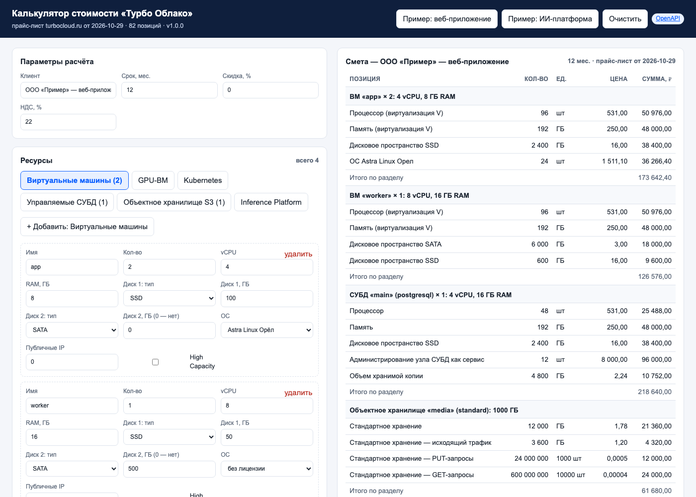

# Turbo Cloud Calculator

Калькулятор стоимости облачных ресурсов «Турбо Облака» (ООО «Турбо», ГК «РТК-ЦОД»).

Программа принимает конфигурацию ресурсов в формате JSON и возвращает смету: строки по каждому ресурсу, сумму без НДС, скидку, НДС и итог. Расчёт идёт по прайс-листу с публичного сайта [turbocloud.ru/prices](https://turbocloud.ru/prices).

Программа работает в четырёх режимах:

- веб-интерфейс (`/`): форма конфигурации и смета в браузере;
- библиотека Python (`turbo_calc`);
- интерфейс командной строки (`turbo-calc`);
- REST API на FastAPI (`/v1/estimate`).

## Возможности

| Сегмент | Что считает |
| --- | --- |
| Виртуальные машины | vCPU, RAM, диски SATA/SAS/SSD, лицензии ОС, публичные IP; профиль High Capacity |
| GPU-инфраструктура | кластеры L40S, L4, H200; профили MIG для H200 |
| Kubernetes | control plane (HA или одиночный), узлы, диски узлов, постоянные тома, администрирование узлов |
| Управляемые СУБД | PostgreSQL, MySQL, Pangolin, MongoDB, Redis, ClickHouse, Qdrant, RabbitMQ, Kafka, Tarantool; хранение резервных копий |
| Объектное хранилище S3 | тарифы standard, cold, fixed; трафик и запросы PUT/GET |
| Резервное копирование | защищаемый объём и объём хранимых копий |
| Inference Platform | почасовая оплата VRAM на H200 и SSD |
| Сеть | публичные IP, безлимитные каналы от 5 Мбит/с до 10 Гбит/с |

Все денежные значения — `Decimal`. Каждая строка округляется до копейки по правилу `ROUND_HALF_UP`. Итоги равны сумме округлённых строк. Это исключает расхождения с бухгалтерским расчётом.

## Установка

Требуется Python 3.11 или новее.

```bash
git clone https://github.com/MABobrov/turbo-cloud-calculator.git
cd turbo-cloud-calculator
python -m venv .venv && source .venv/bin/activate
pip install -e ".[dev]"
```

## Использование

### Веб-интерфейс

```bash
turbo-calc serve --port 8000
```

Откройте `http://127.0.0.1:8000/`. Страница позволяет добавить ресурсы кнопками, загрузить два готовых примера, увидеть смету по разделам и скачать её в JSON. Страница — один HTML-файл без сборки (`turbo_calc/static/index.html`); она вызывает тот же `POST /v1/estimate`, что и внешние клиенты.



### Командная строка

1. Опишите конфигурацию в JSON-файле. Примеры лежат в каталоге `examples/`.
2. Выполните расчёт:

```bash
turbo-calc estimate examples/web-app.json            # смета в виде текста
turbo-calc estimate examples/web-app.json --format json
turbo-calc estimate examples/web-app.json --format csv --out smeta.csv
turbo-calc pricelist --category gpu                  # прайс-лист по категории
```

Код возврата `0` — расчёт выполнен. Код `2` — ошибка в конфигурации; список ошибок выводится в `stderr`.

### REST API

```bash
turbo-calc serve --port 8000
curl -s -X POST http://127.0.0.1:8000/v1/estimate \
  -H "Content-Type: application/json" \
  -d @examples/ai-platform.json | python -m json.tool
```

Документация OpenAPI доступна по адресу `http://127.0.0.1:8000/docs`.

| Метод и путь | Назначение |
| --- | --- |
| `GET /` | Веб-интерфейс калькулятора |
| `GET /health` | Проверка работоспособности, версия, дата прайс-листа |
| `GET /v1/pricelist?category=vm` | Прайс-лист, фильтр по категории |
| `GET /v1/pricelist/{sku}` | Одна позиция прайс-листа |
| `POST /v1/estimate` | Расчёт сметы по конфигурации |

Каждый ответ содержит заголовок `X-Request-ID`. Ошибки валидации возвращают код `422` и список полей с ошибками.

### Библиотека

```python
from turbo_calc import Calculator, Configuration

config = Configuration.model_validate({
    "months": 12,
    "vms": [{"name": "app", "vcpu": 4, "ram_gb": 8, "disks": [{"type": "ssd", "size_gb": 100}]}],
})
estimate = Calculator().estimate(config)
print(estimate.total)          # итог с НДС за 12 месяцев
print(estimate.monthly_ex_vat) # среднемесячный платёж без НДС
```

### Docker

```bash
docker build -t turbo-cloud-calculator .
docker run --rm -p 8000:8000 turbo-cloud-calculator
```

Контейнер запускается от непривилегированного пользователя и содержит `HEALTHCHECK` на `/health`.

## Формат конфигурации

Схему входных данных описывают модели в `turbo_calc/models.py`. Неизвестные поля запрещены. Основные разделы:

```json
{
  "customer": "ООО «Пример»",
  "months": 12,
  "discount_percent": 0,
  "vat_percent": 22,
  "vms": [...], "gpu_vms": [...], "kubernetes": [...], "databases": [...],
  "object_storage": [...], "backup": {...}, "inference": [...], "network": {...}
}
```

Полное описание полей — в `docs/requirements.md`. Актуальная JSON-схема доступна по адресу `/openapi.json` запущенного сервера.

## Прайс-лист

Прайс-лист хранится в `turbo_calc/data/pricelist.json`. Файл содержит источник, дату снятия цен, валюту и 82 позиции с кодами SKU. Чтобы обновить цены:

1. Снимите новые цены с сайта turbocloud.ru.
2. Измените значения `price` и поле `captured_at`.
3. Запустите `pytest`. Тесты проверяют целостность прайс-листа и контрольные суммы расчёта.

Калькулятор также принимает внешний прайс-лист: `Calculator(PriceList.from_path("my-prices.json"))`.

## Разработка

```bash
ruff check .          # стиль и ошибки
mypy turbo_calc       # статическая типизация (strict)
pytest                # тесты; порог покрытия 90 %
```

CI в GitHub Actions запускает те же проверки на Python 3.11, 3.12 и 3.13, затем собирает Docker-образ.

## Структура проекта

```
turbo_calc/
  models.py       входные и выходные модели (pydantic v2)
  pricelist.py    загрузка и проверка прайс-листа
  calculator.py   расчёт сметы
  api.py          REST API (FastAPI)
  cli.py          интерфейс командной строки
  static/index.html веб-интерфейс
  data/pricelist.json
tests/            63 теста pytest
examples/         примеры конфигураций
docs/             требования, архитектура, тестирование, эксплуатация
```

## Ограничения

- Цены соответствуют публичному прайс-листу на дату `captured_at`. Индивидуальные тарифы и акции не учитываются.
- Калькулятор не учитывает лицензии прикладного ПО (SaaS) и профессиональные сервисы.
- Расчёт справочный. Юридическую силу имеет коммерческое предложение ООО «Турбо».

## Лицензия

MIT. См. файл `LICENSE`.
